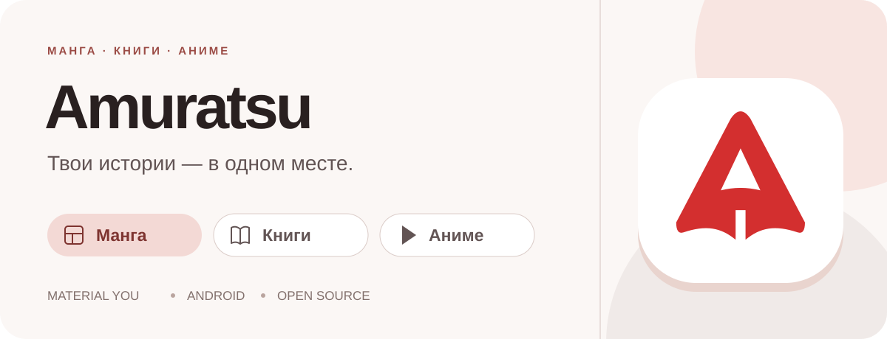

<p align="center">
  
</p>

<p align="center">
  
  
  <a href="LICENSE"></a>
</p>

<p align="center">
  <a href="#возможности">Возможности</a> ·
  <a href="#начало">Начало</a> ·
  <a href="#сборка">Сборка</a> ·
  <a href="https://github.com/amurapan/amuratsu/issues">Обратная связь</a>
</p>

**Amuratsu** — приложение для манги, ранобэ, фанфиков и аниме.
Одна библиотека, общий поиск и быстрый возврат к истории, на которой остановился.
Проект развивается на основе [Kototoro](https://github.com/Kototoro-app/Kototoro)
с собственной главной страницей и оформлением **Material You**.

> **Ранняя alpha · 0.1.0-alpha.2**
>
> Основное направление сейчас — Android. Новая главная, чтение и обновление поверх предыдущей
> тестовой версии проверены на эмуляторе. Работа сетевых источников, воспроизведение и плавность
> ещё требуют проверки на реальных устройствах. Публичные сборки Amuratsu пока не опубликованы.

## Возможности

| | |
| :--- | :--- |
| **Твои истории**<br>Продолжение чтения и просмотра прямо с главной. Фильтры «Манга», «Книги» и «Аниме». | **Общий поиск**<br>Поиск по подключённым источникам с выбором типа медиа. Для нового запроса не нужно сначала менять раздел. |
| **Material You**<br>Динамические цвета, округлые карточки и адаптивный интерфейс для разных размеров экрана. | **Чтение под себя**<br>Светлая и тёмная темы, AMOLED и отдельные настройки читалки, включая сепию. |
| **Своя библиотека**<br>Коллекции, история, загрузки и сохранение прогресса чтения. | **Локальные файлы**<br>Импорт книг, архивов манги и видео. Поддержка расширений и источников из основы Kototoro. |

### Что можно читать и смотреть

| Формат | В приложении |
| :--- | :--- |
| Манга и комиксы | Читалка страниц, главы и сохранение позиции |
| Ранобэ, романы и фанфики | Текстовая читалка, настройка оформления и импорт EPUB/TXT |
| Аниме и видео | Видеоплеер, эпизоды, субтитры и выбор аудиодорожки |

Доступность произведений и отдельных функций зависит от выбранного источника и формата файла.
Произведения и подписки в комплект приложения не входят.

## Начало

1. Установи тестовую сборку Amuratsu или [собери APK](#сборка) самостоятельно.
2. Подключи нужные источники в настройках либо импортируй локальный файл.
3. Найди произведение через общий поиск и добавь его в библиотеку.
4. Возвращайся к нему через блок **«Продолжить»** на главной.

Для Android нужен **Android 8.0 или новее**. Текущая локальная preview-сборка рассчитана на **ARM64**.
Публичные APK будут появляться в [Releases](https://github.com/amurapan/amuratsu/releases).
Код desktop и iOS унаследован от Kototoro и адаптируется; собственные пакеты для этих платформ пока не выпущены.

## Планы

- [ ] Доработать отдельные пространства манги, книг и аниме с сохранением общего поиска.
- [ ] Проверить основные источники и сделать их первоначальную настройку удобнее.
- [ ] Проверить прокрутку и переключение вкладок на реальных устройствах.
- [ ] Подготовить публичные сборки и настроить их обновление.

## Сборка

Нужны **JDK 17+** и Android SDK/NDK, указанные в [конфигурации проекта](app/build.gradle).
Путь к SDK задаётся через `ANDROID_HOME` или локальный `local.properties`.

```sh
git clone https://github.com/amurapan/amuratsu.git
cd amuratsu
./gradlew :app:assemblePreview
```

APK появится здесь:

```text
app/build/outputs/apk/preview/app-arm64-v8a-preview.apk
```

Preview использует релизную оптимизацию и локальный тестовый ключ подписи.
Чтобы установить обновление поверх прежней тестовой версии с сохранением данных,
используй тот же ключ подписи. Публичные релизы потребуют отдельной настройки подписи.

<details>
<summary><strong>Для разработки</strong></summary>

```sh
# Отладочная сборка
./gradlew :app:assembleDebug

# Проверка компиляции
./gradlew :app:compileDebugKotlin

# JVM-тесты
./gradlew :app:testDebugUnitTest --no-daemon
```

- [Главная и навигация](docs/development/media-navigation.md)
- [Брендинг и совместимость](docs/development/amuratsu-branding.md)
- [Общие компоненты интерфейса](docs/architecture/shared-ui-guidelines.md)

Часть технической документации описывает исходный Kototoro. Его имена пакетов и форматы
данных сохранены для совместимости; отображаемое название приложения — Amuratsu.

</details>

## Обратная связь

Нашёл ошибку или придумал улучшение — [создай issue](https://github.com/amurapan/amuratsu/issues).
Для ошибки пригодятся версия приложения, модель устройства, версия Android и шаги воспроизведения.

## Основа проекта

Amuratsu — форк [Kototoro](https://github.com/Kototoro-app/Kototoro), который вырос из
[Kotatsu](https://github.com/KotatsuApp/Kotatsu). Спасибо skepsun и всем участникам исходных проектов.
Их работа, история изменений и авторские уведомления сохранены.

<details>
<summary><strong>Проекты, на которых основана работа</strong></summary>

- [Mihon](https://github.com/mihonapp/mihon)
- [Yomihon](https://github.com/yomihon/yomihon)
- [KotatsuApp/Kotatsu](https://github.com/KotatsuApp/Kotatsu) as the original source/UI base that Kototoro was initially derived from
- [kotatsu-redo](https://github.com/Kotatsu-Redo/Kotatsu-Redo) for the implementation inspiration behind automatic background handling of Cloudflare detection
- [Venera](https://github.com/venera-app/venera)
- [Kazumi](https://github.com/Predidit/Kazumi)
- [Light Novel Yuedu Source](https://github.com/ZWolken/Light-Novel-Yuedu-Source)
- [legado-with-MD3](https://github.com/HapeLee/legado-with-MD3)
- [RealCUGAN-ncnn-Android](https://github.com/omeshi1/RealCUGAN-ncnn-Android)
- [manga-translator-ui](https://github.com/hgmzhn/manga-translator-ui)
- [kotatsu-redo](https://github.com/Kotatsu-Redo/Kotatsu-Redo) for the e-ink reading mode
- [BiliPai](https://github.com/jay3-yy/BiliPai) for inspiring the ExoPlayer/Media3-based video super-resolution
- [DropSauce](https://github.com/HuzaifaKhalid1311/DropSauce) for inspiring the Google Drive sync feature
- [AndroidLiquidGlass](https://github.com/Kyant0/AndroidLiquidGlass) for the liquid glass (backdrop) effect
- [Futon](https://github.com/AppFuton/Futon) for inspiring the global tag blacklist feature

</details>

## Лицензия

[Apache License 2.0](LICENSE). Исходное уведомление об авторских правах:

```text
Copyright © 2024-2026 Kototoro Open Source Project

Licensed under the Apache License, Version 2.0 (the "License");
you may not use this file except in compliance with the License.
You may obtain a copy of the License at

    http://www.apache.org/licenses/LICENSE-2.0

Unless required by applicable law or agreed to in writing, software
distributed under the License is distributed on an "AS IS" BASIS,
WITHOUT WARRANTIES OR CONDITIONS OF ANY KIND, either express or implied.
See the License for the specific language governing permissions and
limitations under the License.
```
