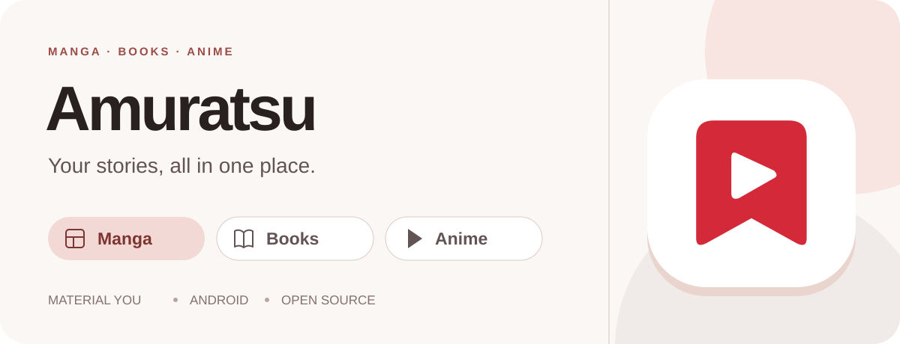

<p align="center">
  
</p>

<p align="center">
  
  
  <a href="LICENSE"></a>
</p>

<p align="center">
  <a href="#features">Features</a> ·
  <a href="#getting-started">Getting started</a> ·
  <a href="#build">Build</a> ·
  <a href="https://github.com/amurapan/amuratsu/issues">Feedback</a>
</p>

**Amuratsu** is an app for manga, light novels, fanfiction, and anime.
One library, search across media types, and a quick way to pick up where you left off.
Built on [Kototoro](https://github.com/Kototoro-app/Kototoro), with its own home screen
and **Material You** design.

> **Android alpha · 0.1.0-alpha.3**
>
> This is an early build for testing. Source availability depends on the selected extension,
> and scrolling and tab switching still need testing on physical devices.

## Features

| | |
| :--- | :--- |
| **Your stories**<br>Continue reading or watching from the home screen. Filter by Manga, Books, or Anime. | **One search**<br>Search connected sources across media types without switching sections first. Narrow the results by format when needed. |
| **Material You**<br>Dynamic colors, rounded cards, and layouts that adapt to different screen sizes. | **Reading your way**<br>Light, dark, and AMOLED themes, plus separate reader settings, including sepia. |
| **Your library**<br>Collections, history, downloads, and saved reading progress. | **Local files**<br>Import books, manga archives, and videos. Source and extension integrations are inherited from Kototoro. |

### What you can read and watch

| Format | In the app |
| :--- | :--- |
| Manga and comics | Page reader, chapters, and saved position |
| Light novels, novels, and fanfiction | Text reader, appearance settings, and EPUB/TXT import |
| Anime and video | Video player, episodes, subtitles, and audio track selection |

Content availability and individual features depend on the source and file format.
The app does not include media or subscriptions.

## Getting started

1. Download the [Android alpha](https://github.com/amurapan/amuratsu/releases/tag/v0.1.0-alpha.3)
   or [build a local preview](#build).
2. From Home or Search, open **Manage content sources**. Add a catalog or enter your own repository URL.
3. Open **Packages** to filter by language and install individual sources. You can also import local files from Home.
4. Search all formats and use **Continue** on Home to return to your saved position.

Requires **Android 8.0 or later**. The current local preview build targets **ARM64**.
The public APK uses Amuratsu’s own app ID and signing key. To move from an older test build, export
a backup in **Settings → Backup and restore**, then restore it in the public app. Reimport local files separately. They may appear as new entries and need their
reading position set again.
Future public updates are available through **About → Updates** and [GitHub Releases](https://github.com/amurapan/amuratsu/releases).
Desktop and iOS code is inherited from Kototoro and is being adapted; Amuratsu packages for those platforms are not yet available.

## Roadmap

- [x] Add separate Home views for manga, books, and anime with shared search.
- [x] Offer Keiyoushi, Yūzōnō, and LNReader Plugins as optional catalogs.
- [x] Prepare signed Android builds and check for updates from Amuratsu Releases.
- [ ] Test more sources and check scrolling and tab switching on physical devices.

## Build

You need **JDK 17+** and the Android SDK/NDK specified in the [project configuration](app/build.gradle).
Set the SDK path through `ANDROID_HOME` or a local `local.properties` file.

```sh
git clone https://github.com/amurapan/amuratsu.git
cd amuratsu
./gradlew :app:assemblePreview
```

The APK will be generated at:

```text
app/build/outputs/apk/preview/app-arm64-v8a-preview.apk
```

Preview uses release optimizations and a local test signing key.
Use the same signing key to install over a previous test version while keeping its data.
Public releases will require a separate signing setup.

<details>
<summary><strong>For development</strong></summary>

```sh
# Debug build
./gradlew :app:assembleDebug

# Compile check
./gradlew :app:compileDebugKotlin

# JVM tests
./gradlew :app:testDebugUnitTest --no-daemon
```

- [Home screen and navigation](docs/development/media-navigation.md)
- [Branding and compatibility](docs/development/amuratsu-branding.md)
- [Shared UI guidelines](docs/architecture/shared-ui-guidelines.md)

Some technical documentation still describes the upstream Kototoro project. Its package names
and data formats are retained for compatibility; the displayed app name is Amuratsu.

</details>

## Feedback

Found a bug or have an idea? [Open an issue](https://github.com/amurapan/amuratsu/issues).
For bugs, include the app version, device model, Android version, and steps to reproduce the problem.

## Built on

Amuratsu is a fork of [Kototoro](https://github.com/Kototoro-app/Kototoro), which originated from
[Kotatsu](https://github.com/KotatsuApp/Kotatsu). Thanks to skepsun and everyone who contributed to the upstream projects.
Their work, commit history, and copyright notices are preserved.

<details>
<summary><strong>Projects behind the app</strong></summary>

- [Mihon](https://github.com/mihonapp/mihon)
- [Yomihon](https://github.com/yomihon/yomihon)
- [KotatsuApp/Kotatsu](https://github.com/KotatsuApp/Kotatsu) as the original source/UI base that Kototoro was initially derived from
- [kotatsu-redo](https://github.com/Kotatsu-Redo/Kotatsu-Redo) for the implementation inspiration behind automatic background handling of Cloudflare detection
- [Venera](https://github.com/venera-app/venera)
- [Kazumi](https://github.com/Predidit/Kazumi)
- [Light Novel Yuedu Source](https://github.com/ZWolken/Light-Novel-Yuedu-Source)
- [legado-with-MD3](https://github.com/HapeLee/legado-with-MD3)
- [RealCUGAN-ncnn-Android](https://github.com/omeshi1/RealCUGAN-ncnn-Android)
- [manga-translator-ui](https://github.com/hgmzhn/manga-translator-ui)
- [kotatsu-redo](https://github.com/Kotatsu-Redo/Kotatsu-Redo) for the e-ink reading mode
- [BiliPai](https://github.com/jay3-yy/BiliPai) for inspiring the ExoPlayer/Media3-based video super-resolution
- [DropSauce](https://github.com/HuzaifaKhalid1311/DropSauce) for inspiring the Google Drive sync feature
- [AndroidLiquidGlass](https://github.com/Kyant0/AndroidLiquidGlass) for the liquid glass (backdrop) effect
- [Futon](https://github.com/AppFuton/Futon) for inspiring the global tag blacklist feature

</details>

## License

[Apache License 2.0](LICENSE). Original copyright notice:

```text
Copyright © 2024-2026 Kototoro Open Source Project

Licensed under the Apache License, Version 2.0 (the "License");
you may not use this file except in compliance with the License.
You may obtain a copy of the License at

    http://www.apache.org/licenses/LICENSE-2.0

Unless required by applicable law or agreed to in writing, software
distributed under the License is distributed on an "AS IS" BASIS,
WITHOUT WARRANTIES OR CONDITIONS OF ANY KIND, either express or implied.
See the License for the specific language governing permissions and
limitations under the License.
```
